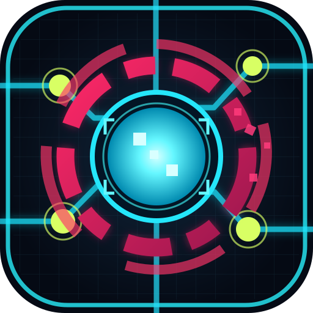

## Extended Red Zone // Data Cities

The Withnet now extends through **Neon Bazaar**, **Ghost Port**, and **Cipher Citadel**. Each new district has a discoverable data-city terminal, a local market for repairs and trace removal, two patrol ICE units and a tougher named boss. Boss defeats award extra credits and fragments. Nine proximity-triggered signal mines initiate rhythm countermeasure encounters; losing triggers 25 seconds of narrow visibility and temporarily disables the mini-radar, making guards difficult to track. Defusing a mine earns a credit reward. Existing save files remain compatible.

# CYBERLOAD // NET.RUNNER

**v0.6.0 — Red Zone Security & ICE Patrols**

A mobile-first, offline, code-drawn 2D cyberpunk exploration prototype made with **Godot 4.4.1 / GDScript**.



## What's new in v0.6 — Red Zone Security

Sector C is now **physically protected by a continuous animated red firewall** at world X = 1395. Players can still move freely in sectors A and B. Attempts to cross from the public Withnet into the Red Zone automatically start a Breach Protocol minigame unless the player has Clearance Level 2.

- **Two independent barriers:** the outer Sector C firewall and the inner Darknet ICE portal. Breaching the outer wall does not automatically open the inner Darknet gate.
- **Per-visit access:** after a successful firewall hack, the outer wall lets the player travel freely until the next uplink/Homebase visit. A failed breach adds trace and returns the player to the public side.
- **Homebase Clearance // 08:** buy permanent security levels with Credits and Data Fragments. Level 1 adds 18 seconds to outer firewall hacking; Level 2 bypasses the Red Zone wall entirely. Costs are 90 CR + 8 DATA, then 170 CR + 18 DATA.
- **Three roaming guards:** Patrol ICE (level 1), Shield Sentinel (level 2) and Red Hunter (level 3) with independent patrol patterns and detection areas. Entering a guard's range triggers the existing rhythm combat.
- **Combat:** defeating a guard marks it offline until the next Withnet session and grants extra resources. Losing increases Trace and ejects the runner to the safe side of the barrier.
- **New minimap, HUD and operator-log information** includes guards and Clearance status; the zone has ambient warning lines and moving red security visuals.
- **Save compatibility:** clearance level, number of firewall hacks and total defeated guards are appended to the existing save file `user://cyberload_save_v03.json`. Older v0.3–v0.5 saves load with Clearance 0.
- **Tests:** `tests/red_zone_smoke.gd` checks boundary crossing, guard detection/defeat, Clearance levels, and persistence; `tests/world_smoke.gd` checks the new two-stage access route.

### Recommended first journey

Homebase → Uplink → Sectors A and B → Red firewall breach → Defeat or evade Red Zone guards → Darknet gate breach → Darknet mission → return to Homebase.

## What's new in v0.5

Cyberload now has a separate data-driven **rhythm battle engine**, an actual craftable hacker loadout and permanent Homebase modules. Existing save files from v0.3 and v0.4 are read without erasing progress.

### Homebase additions
- **FABRICATOR // 06**: choose **Craft Programs** for Logic Bomb, Mirror Shield or Overdrive; buy programs using Credits + Data Fragments. Select **Open Loadout** to equip any owned program. The starter `BASIC_SPIKE` always remains available.
- **MODULE // 05**: permanent home upgrades: **FIREWALL** reduces battle damage, **AMPLIFIER** adds attack damage, **SYNC** widens the valid rhythm timing window. Installed modules are visible in the base near the central core.
- **ARMORY // 07**: open the Loadout or start a safe ICE training duel; training does not subtract real integrity or grant money.
- **ICE // ARENA**: new combat terminal in Sector C of the public Withnet.
- In the Darknet, reaching the ICE sentinel starts the same duel system; defeating it disables the hunter until the next visit.

### Rhythm mini-game controls
Combat alternates between **ATTACK** (arrows flying left → right) and **DEFEND** (ICE arrows flying right → left). Four arrows travel along a single lane toward the **central circular target**, with upcoming arrows visible in advance. Tap the matching direction inside the ring; arrow keys or W/A/S/D work too. Early inputs do not consume a note. In DEFEND, each accurately blocked arrow prevents one quarter of incoming damage; a perfect 4/4 block means zero HP lost even against elite ICE. Missed arrows alone cause damage, and MIRROR_SHIELD forgives one missed arrow while FIREWALL reduces the remaining damage. Level 1 ICE runs at 40 BPM, scaling up to level 5 at ~91 BPM with narrower hit windows. Homebase Fabricator sells a permanent **CHRONO_HACK** for 120 credits and 12 data: two on-demand **SLOWMO** charges per duel, each lasting 7 real seconds and slowing the beat clock to 52%. Trigger via the on-screen button or Space. This utility works with any equipped attack program; SYNC extends timing tolerance. Training is risk-free.

### Progression and test coverage
- New saved fields: `owned_programs`, `active_program`, `installed_modules`, `ice_wins`, `ice_losses`. Data remains in the existing `user://cyberload_save_v03.json` save path for upgrade compatibility.
- `scripts/rhythm_combat.gd` isolates turn/timing/damage logic from rendering.
- `tests/progression_smoke.gd` verifies crafting, insufficient ownership, module purchase, saving/reloading, and successful attack/defense rounds.
- `tests/world_smoke.gd` checks Fabricator and Armory routing as well as the Homebase/Withnet connections.

## What's new in v0.4

- Every app launch **starts in the private Homebase**, including returning players; existing v0.3 save files and earned resources remain compatible.
- Homebase is a safe, freely navigable room with a central system kernel and five interactive terminals: **UPLINK**, **CORE**, **WORKSHOP**, **ARCHIVE**, **OPS**.
- **UPLINK** takes you into the public Withnet. Interact with the **HOMEBASE** portal on the west end of the Withnet highway to return at any time.
- Withnet is divided into **Sector A / Public Data**, **Sector B / Services**, and **Sector C / Red Zone**. Its main east-west data highway, branch lanes, district boundaries, labels and animated traffic replace the old crisscross connections.
- The upper-right **network overview mini-map** shows your bit, node locations, the Homebase connection, and the ICE gate.
- The **RELAY** node now has a return-to-Homebase action instead of merely changing your Withnet position.
- Headless world integration checks verify startup location and Base → Withnet → Base transitions in GitHub Actions.

### Suggested first mission

1. Fly from your spawning circle in Homebase to **UPLINK // 00**, tap **HACK** and select **ENTER WITHNET**.
2. Travel east along the cyan **data highway** into **Sector A**, and harvest **NODE // 00** data.
3. Go to **NODE // 01** (Scanner) in Sector A and reveal the secret vault.
4. Continue along the highway to the red ICE gate in **Sector C**, breach it, gather all three Darknet packets, and escape.
5. Return to Homebase with the western portal or the Service-sector Relay console.

## Gameplay loop
1. Explore the open **Withnet** as a glowing data bit.
2. Approach a colored Node and tap **HACK** to open its terminal.
3. Extract data, scan for hidden nodes, buy upgrades, heal, or accept a risk.
4. Breach the red ICE gateway with a timed alternating row/column code matrix.
5. Enter a dangerous **Darknet maze**: collect three packets, dodge the moving ICE sentinel, and escape through the exit.
6. Spend credits/fragments, increase buffer and speed, and complete the five-stage contract.

## Functional nodes

| ID | Type | Operations |
|---|---|---|
| 00 | DATA | Extract one-time credits and fragments |
| 01 | SCAN | Reveal hidden GHOST node; lower trace |
| 02 | UPGRADE | Buy speed or buffer upgrades |
| 03 | MARKET | Buy trace scrub or restore HP |
| 04 | MISSION | View current story contract |
| 05 | RELAY | Repair and fast-travel back to uplink |
| 06 | ANOMALY | Trade risk/trace for valuable rare cache |
| 07 | SECRET VAULT | Scanned hidden bonus cache |

Free roaming data pickups, a moving ICE sentinel, a 3-packet Darknet extraction condition, buffer upgrades, an integrity meter and trace risk all work without any internet connection.

## Input

**Android:** drag the left joystick and tap **HACK** near a base terminal, public node or ICE gate. In a terminal, tap option 1 or 2. Tap the title to see the operator log. In the code matrix, tap cells in alternating same-column / same-row order.

**Desktop:** WASD / arrow keys move, E / Space interact, 1 or 2 choose node operations, M / Tab open operator log, Escape close.

## Save system

Game data is stored locally in `user://cyberload_save_v03.json` by `scripts/game_state.gd`. It includes wallet, upgrades, mission stage, cleared caches and discovered secrets. No login, telemetry or network permissions are used. Changes to save schema should be versioned carefully. Uninstalling the debug APK deletes this data.

## Graphic design

All gameplay graphics are generated in `scripts/main.gd` using Godot 2D drawing commands. The actual app icon is `assets/icon.svg`: a cyan data core breaching a pink ICE firewall ring. Before Android export, `tools/make_icons.py` converts that SVG to a classic 192px PNG and 432px adaptive foreground/background layers.

To generate Android PNGs locally (optional):
```bash
python -m pip install cairosvg
python tools/make_icons.py
```

## Build and test

- Install **Godot 4.4.1**, open `project.godot`, run F5.
- GitHub Actions workflow `.github/workflows/android-apk.yml` runs project import and smoke tests and exports an arm64 debug APK.
- Open **Actions → Android Debug APK → latest successful run → Artifacts → Cyberload-debug-apk**.
- Unzip the artifact and install the APK on your Android phone.

**Signing caveat:** the workflow currently creates a new temporary debug keystore on each run. This prevents seamless upgrades between debug APKs. A persistent signing key stored as GitHub Actions secrets is required before user data and update continuity matter.

## Source structure

| File | Responsibility |
|---|---|
| `project.godot` | Engine, render, landscape, icon and input settings |
| `scenes/main.tscn` | Scene entry point |
| `scripts/main.gd` | Open map, maze, input, effects, breach, nodes, game UI |
| `scripts/game_state.gd` | Economy, upgrades, contract progression, programs/modules and local save |
| `scripts/rhythm_combat.gd` | Four-input timed attack/defense combat rules and rewards calculations |
| `scripts/red_zone.gd` | Sector firewall bounds, guard patrols, detection and defeat flags |
| `assets/icon.svg` | Editable vector brand icon |
| `tools/make_icons.py` | Generates PNG launcher icons for Android |
| `export_presets.cfg` | Android ID, version and icon resource paths |

## Planned milestones

- v0.4: procedural network maps, inventory/deck building, varied ICE guards and richer missions.
- v0.5: implemented rhythm combat, program crafting, permanent base modules and ICE training arena.
- v0.6+: WLAN room discovery and synchronized turn-based netrunner battles, then Bluetooth evaluation.

This repository is a **playable prototype**, not a production release. See the GitHub Actions log if an export fails.
