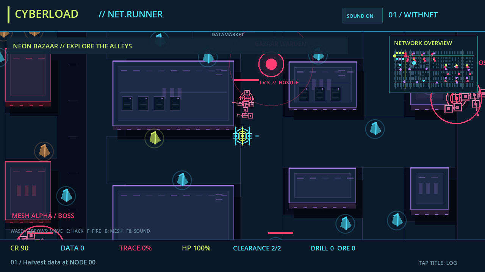

# CYBERLOAD // NET.RUNNER

**v0.7.0 — Dataverse: Data Cities, Ambushes & Living Subnets**

Ein offline spielbares Cyberpunk-Erkundungsspiel für **Android** und den **Godot-PC-Editor**. Baue einen modularen Mesh-Runner, erkunde Withnet und Red Net, zerlege feindliche Bots und hacke ihre freigelegten Kerne.

## Neu in dieser Version

- **Datenlandschaften statt verstreuter Hindernisse:** Acht vernetzte Regionen mit großen Datengebäuden, beleuchteten Hauptstraßen, schmalen Gassen, Querwegen, Plätzen und Flüssigdaten-Kanälen. Terminals und Dungeon-Portale haben eigene Zugänge. Schatten, Fassaden, Dachdetails, schwebende Portale und Datenströme geben der bisherigen Code-Grafik mehr räumliche Tiefe.
- **Bewegung mit Trägheit:** Feste Physikschritte mit kurzen Unterteilungen, Beschleunigung, Abbremsen, Wandgleiten, Rückstoß, weiche Richtungswechsel und eine nachlaufende Kamera. CRAWL, SWIM und FLY behalten unterschiedliche Fahreigenschaften. Sichtbare Wasserflächen und der Schwimmbonus benutzen dieselben Flächendaten. Laufanimationen funktionieren auch in Basis und Dungeons.
- **Bots mit Deckung und Hinterhalten:** Mesh-Bots suchen Wege durch die Gassen und feuern nur bei freier Sicht. Lurker warten an Gebäudeecken; ein sicht- und hörbares Warnsignal kündigt den Angriff an. Ihre Signalfallen benötigen eine zusätzliche Sekunde zum Scharfwerden, verlangsamen kurzzeitig und verschwinden wieder. Geschosse werden entlang ihrer gesamten Flugstrecke auf Wände geprüft.
- **Immersivere Hacks:** Animierte Datentunnel, ein rotierender ICE-Kern, beleuchtete gültige Matrixfelder, sichtbare Codeverbindungen, Impulse und dezente synthetische Töne. Das bekannte Pfeil-Timing, Code-Bomben und Slowmo bleiben erhalten. Ton lässt sich per Schaltfläche oder **F8** ausschalten; die Einstellung wird gespeichert.
- **Jeder Dungeon-Eintritt erzeugt einen neuen Grundriss:** Zufällig angeordnete Räume, breite Verbindungen, Abzweigungen und zusätzliche Rundwege statt eines festen Musters. Vier optische Themen, drei Datentruhen, Wächter und ein entfernter Boss. Auch das geschützte **Darknet hinter dem ICE-Gate** nutzt den Generator. Eine Mini-Karte zeigt die aktuelle Topologie.
- **Fortschritt bleibt erhalten:** Gesammelte Dungeon-Truhen behalten ihre festen Belohnungsslots, auch wenn ihre Positionen wechseln. Der seltene Boss-Erstbonus wird nur einmal je Portal vergeben. Bereits besiegte Bosse lassen sich in einem neuen Layout erneut bekämpfen; der wiederholte Kreditbonus fällt kleiner aus.



Weitere Spielansichten: [Generierter Dungeon](docs/screenshots/subnet.png) · [ICE-Netduell](docs/screenshots/netduel.png)

## APK und Godot-Projekt herunterladen

Jeder erfolgreiche [GitHub-Actions-Build](https://github.com/Inrouder/Cyberload/actions/workflows/android-apk.yml) veröffentlicht:

| Artefakt | Inhalt |
| --- | --- |
| **Cyberload-debug-apk** | Android-APK zum Testen, ARM64, mit Debug-Signatur |
| **Cyberload-Godot-Project** | Vollständiges Godot-Projekt als ZIP für PC-Tests |

Öffne einen erfolgreichen Lauf und lade die beiden Artefakte unten auf der Seite herunter. Für den PC: ZIP entpacken, **project.godot** in **Godot 4.4.1** importieren und **F5** drücken. Ein Android-SDK ist nur für APK-Exporte erforderlich. Der Build prüft alle Skripte und Tests vor dem Export.

## Steuerung

| Aktion | PC | Android |
| --- | --- | --- |
| Bewegen | WASD oder Pfeiltasten | Linker Joystick |
| Terminal, Portal, Truhe oder Kern hacken | E / Leertaste | HACK oder nahes Objekt antippen |
| Mesh-Gegner beschießen | F | FIRE |
| Mesh-Editor | B oder Fabricator | Fabricator in der Basis |
| Journal | M / Tab oder Titel anklicken | Titel antippen |
| Rhythmus-Hack | Pfeiltasten / WASD | Richtungstasten |
| Code-Bombe | Q | BOMB |
| Slowmo | Leertaste, nach Freischaltung | SLOWMO |
| Ton | F8 oder SOUND-Schaltfläche | SOUND-Schaltfläche |
| Menü schließen | Escape | Entsprechende Schaltfläche / Zurück |

## Einstieg

1. Du startest in deiner sicheren **Homebase**. Fabricator, Armory und Upgrade-Terminals bereiten den Runner auf die Reise vor.
2. Verbinde dich über den **Uplink** mit Withnet. Suche Daten, verbessere den Bohrer, kaufe Ausrüstung und entdecke neue Datenviertel.
3. Die rote Sicherheitsgrenze benötigt einen Firewall-Hack oder **Clearance 2**. Das innere ICE-Gate bleibt eine eigene Zugangssperre.
4. Beschieße Mesh-Bots, bis ihr Kern freiliegt. Ein erfolgreicher Kern-Hack bringt die Beute und Mesh-Erfahrung.
5. Über violette Portale erreichst du neue Dungeon-Instanzen. Am Eingangsportal kannst du jederzeit wieder hinaus; Truhen und Boss liegen in erreichbaren Nebenräumen.

## Architektur

| Datei | Aufgabe |
| --- | --- |
| `scripts/main.gd` | Spielablauf, feste Physikschritte, Eingaben, Übergänge und Oberflächen |
| `scripts/open_world.gd` | Stabile Stadtgeometrie, Durchgänge, räumlicher Kollisionsindex, Wegsuche und Flüssigdaten |
| `scripts/dungeon_instance.gd` | Zufällige verbundene Räume und Gänge, Ziele, Seeds und Wegsuche |
| `scripts/ambush_ai.gd` | Sichtlinien, Verfolgung, Gegnergedächtnis, Warnphasen und zeitlich begrenzte Fallen |
| `scripts/data_landscape.gd` | Darstellung derselben Geometrie, Portale, Subnet-Radar und Hack-Effekte |
| `scripts/mesh_creature.gd` | Verbundene modulare Körper, Eigenschaften und Bewegungsanimationen |
| `scripts/rhythm_combat.gd` | Timing, Angriff, Abwehr, Code-Bomben und Slowmo |
| `scripts/cyber_audio.gd` | Kleine vorab erzeugte Klangsignale ohne externe Assets |
| `scripts/game_state.gd` | Offline-Spielstand und kompatibles Laden älterer Speicherstände |

Der bestehende Spielstand bleibt unter `user://cyberload_save_v03.json`. Neue Layouts werden beim Eintritt erzeugt; dauerhafte Belohnungen und Charakterfortschritt bleiben davon unabhängig. Das Withnet selbst bleibt stabil, damit Wege und Orte erlernbar sind.

## Tests

```bash
godot --headless --path . --editor --import --quit
for test in world_smoke progression_smoke fx_smoke open_world_smoke mesh_smoke mesh_physics_smoke red_zone_smoke dataverse_smoke; do
  godot --headless --path . --script "res://tests/$test.gd"
done
```

`dataverse_smoke.gd` prüft **200 reproduzierbare Zufallsgrundrisse**, vollständige Begehbarkeit, alle Dungeon-Ziele, neue Seeds beim Wiedereintritt, Wege zu allen Welt-Terminals und Portalen, Erz- und Bot-Spawns, Deckung, Fallenwarnungen, einmaliges Auslösen, Framerate-Unabhängigkeit, das generierte Darknet und bereits eingelöste Truhenbelohnungen. Die bisherigen Tests decken zusätzlich Kämpfe, Speichern, Upgrades, Mesh-Bauten und Weltwechsel ab.

Die grafische Prüfung erfolgt mit gerenderten Godot-Ansichten. Mit einer grafischen Sitzung lassen sich die Screenshots über `godot --path . --script res://tools/capture_screenshots.gd` reproduzieren. Das Projekt bleibt ein **2D-Prototyp mit räumlich gezeichneter Grafik**, ohne 3D-Engine-Umbau. Die tatsächliche Android-Leistung und das Spielgefühl sollten zusätzlich auf einem Gerät getestet werden.

Frühere Änderungen, Hintergrund und der Entwickler-Cheat stehen in der [Entwicklungshistorie](docs/DEVELOPMENT_HISTORY.md).
